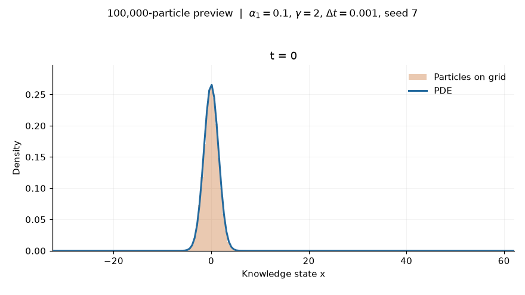
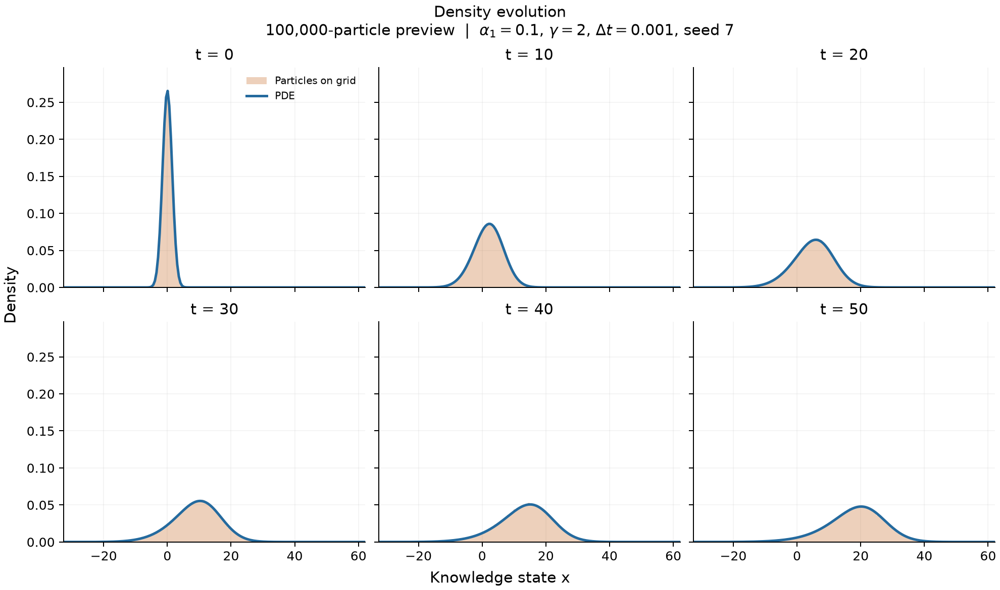
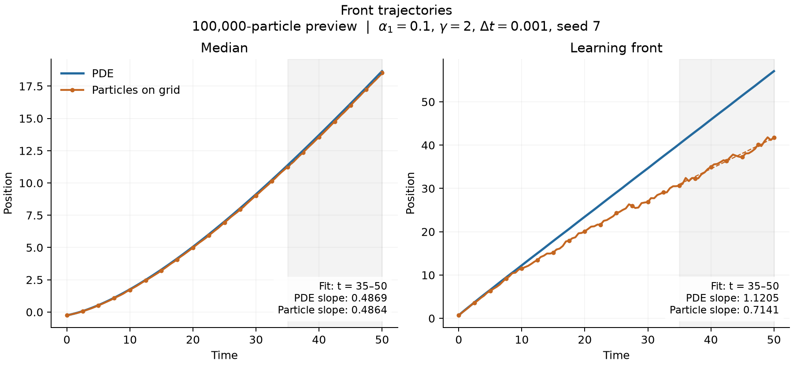
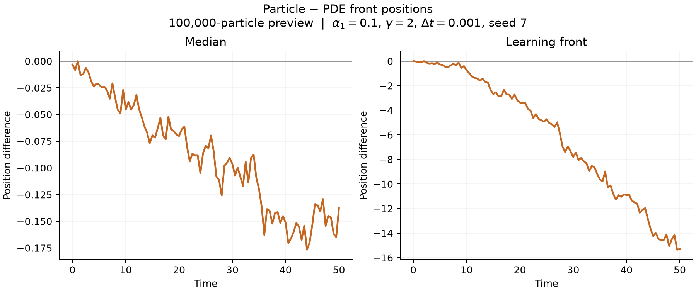
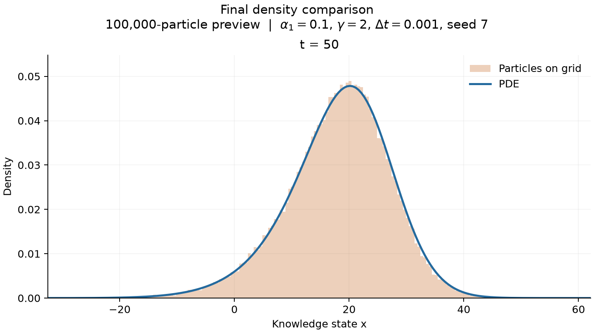

# Corrected 100,000-particle preview

This is a new simulation with the corrected runner, using **100,000 particles**.
It is not a rerun at the original two-million-particle scale. The time horizon,
PDE grid, timestep, learning parameters, initial law, and random seed match
`configs/research.json`; only the particle count differs.

| Parameter | Value |
| --- | --- |
| Particles | 100,000 |
| Time interval | 0–50 |
| Timestep | 0.001 |
| PDE grid | 500 points on [-50, 200] |
| Learning rule | alpha1 = 0.1, gamma = 2 |
| Diffusion coefficient | 1 |
| Initial law | Gaussian, mean 0, standard deviation 1.5 |
| Seed | 7 |
| Saved times | Every 0.5 time units, including 0 and 50 |
| Slope-fit window | 35–50 for both models |

## Density evolution





The density panels use fixed axes across times. Their display window contains
the central 99.98% of each saved grid density and all finite measured fronts,
with padding. This is a display zoom; the numerical data retain the full PDE
grid. The [figure manifest](figure_manifest.json) records the exact window.

## Fronts and final density







Dashed segments and the shaded time window identify the common finite-window
slope fits. A single seed and population size do not establish the cause of a
front discrepancy or convergence as particle count increases.

## Run diagnostics and finite-window slopes

| Observable | PDE slope | Particle slope |
| --- | ---: | ---: |
| Median | 0.486871 | 0.486420 |
| Learning front | 1.120516 | 0.714070 |

Both fits use the same 31 saved times from 35 to 50. No density mass was
clipped, the maximum pre-normalization PDE mass drift was
5.55e-16, and no particles were outside the histogram grid at saved times.
The median slopes are close and a learning-front gap remains in this run;
this is descriptive evidence from a single smaller population, not a
convergence or causal study.

## Files and reproduction

- [Particle-only animation](particles.gif)
- Vector figures: [fronts](fronts.svg), [front differences](front_differences.svg),
  [final densities](density.svg), [density snapshots](density_snapshots.svg)
- [Front measurements](fronts.csv)
- [Simulation metadata and diagnostics](metadata.json)
- [Figure settings and input hashes](figure_manifest.json)

From the repository root:

```bash
python -m lucas_moll --config configs/preview.json --no-plots --output results/preview
python -m lucas_moll.render results/preview --output results/preview/figures --label '100,000-particle preview' --gif
```

The raw snapshot archive remains in the local run directory. The simulation
metadata identifies the exact source revision and numerical environment;
the figure manifest also records the renderer source hash.
